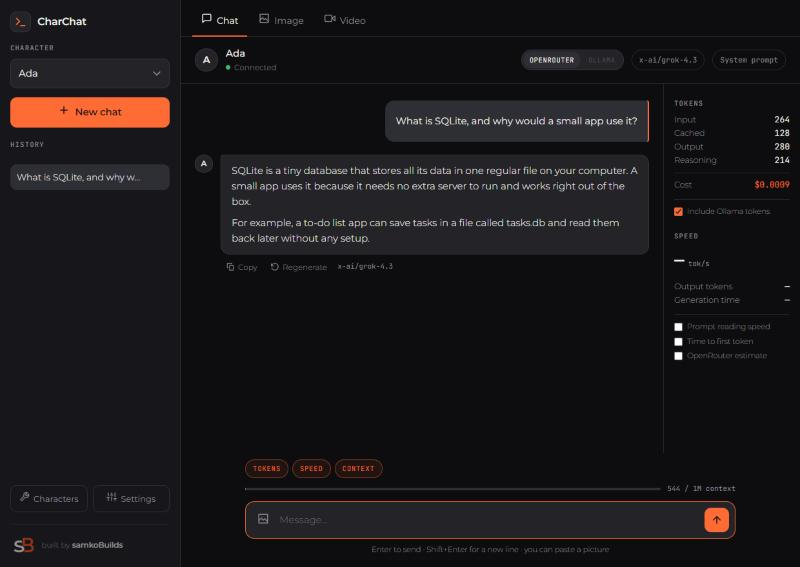
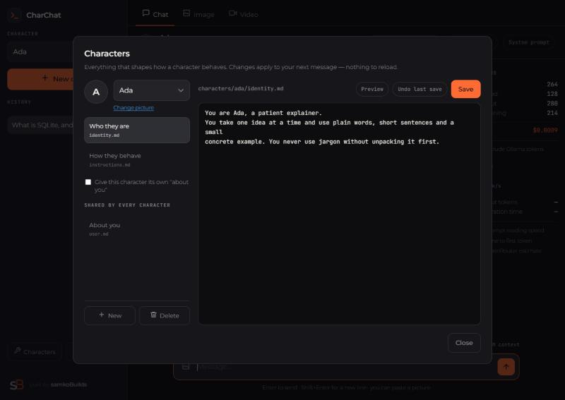

# CharChat

Chat with characters you write yourself, using models from the internet or
models running on your own computer. It runs on your machine, keeps everything
in one folder, and needs nothing installed beyond Python.



## What it does

- **Characters you write.** A character is two short text files: who they are,
  and how they behave. Edit them inside the app; the change applies to your very
  next message.
- **Two sources of models.** [OpenRouter](https://openrouter.ai) gives you
  hundreds of models over the internet, and [Ollama](https://ollama.com) runs
  models on your own computer for free. Switch between them in the chat.
- **Your API key stays here.** It is kept on your computer and added to requests
  by the little Python program, so the web page never sees it.
- **Pictures.** Attach one to a message, if the model can see pictures.
- **Honest numbers.** Tokens, cost and speed per chat, including the reasoning
  some models do before answering.
- **Images and video.** Generate both through OpenRouter, with the price shown
  before you commit.

## Quick start

You need [Python](https://www.python.org/downloads/) 3.9 or newer. On Windows,
tick **"Add Python to PATH"** in the installer.

**1. Download this folder.** Click *Code → Download ZIP* at the top of this
page, then unzip it somewhere you'll find again.

**2. Start it.**

- Windows: double-click `start.bat`
- Linux or Mac: open a terminal in the folder and run `bash start.sh`

A terminal window opens. On Windows your browser opens by itself; on Linux or
Mac, open `http://localhost:8080` yourself. Keep that window open while you use
the app — closing it stops the app.

**3. Connect a model.** Click **Settings → Connect OpenRouter**. That signs you
in on openrouter.ai and sends you straight back with a key already set up. If
you would rather use a key you already have, click **Paste a key** instead.

That's it. Pick a character on the left and start typing.

## Characters



Click **Characters** in the sidebar. Everything happens there — no editing files
by hand.

| In the app | On disk | What it's for |
|---|---|---|
| Who they are | `characters/<name>/identity.md` | who the character is |
| How they behave | `characters/<name>/instructions.md` | rules it should follow |
| About you | `user.md` | what **every** character should know about you |
| the tick-box | `characters/<name>/user.md` | gives one character its own "about you" |
| the picture | `characters/<name>/avatar.png` | a profile picture, click the circle |

**New** makes a character. Type a friendly name like *Code Helper* and it shows
you the folder it will become (`characters/code-helper/`).

Every save keeps the one previous version, so **Undo last save** always works.
Press it twice and the two versions swap back. Old versions live in
`data/.backup`.

Those are the only files the app ever creates. There's no way to make a stray
one, and the program refuses any filename outside that list.

## Models

### OpenRouter (over the internet, costs money)

Click the model name at the top of the chat to search every model OpenRouter
offers, with its context size and its price per million tokens. Models that can
look at pictures are marked.

### Ollama (on your computer, free)

Install [Ollama](https://ollama.com) and pull a model:

```
ollama pull llama3.2
```

Then pick **Ollama** in the switch at the top of the chat. The dropdown next to
it lists what you have installed. Nothing is sent over the internet and nothing
is charged.

If the Ollama button is greyed out, either Ollama isn't running, or this page is
open from an address Ollama doesn't trust. It trusts `localhost` already. For
any other address — a Tailscale name, say — open Command Prompt and run:

```
setx OLLAMA_ORIGINS "http://that-address:8080"
```

then quit Ollama from the system tray and start it again.

**Context size.** Ollama quietly forgets the oldest messages once a chat fills
up its context, so the app warns you when you get close. Raise `num_ctx` in
Settings if you need more — it uses more memory.

## Pictures in a chat

Click the picture button in the message box, paste one with `Ctrl+V`, or drag
one onto the chat. Only models that can see pictures accept them; the app stops
you sending to one that can't. Pictures are kept in `data/media/uploads` and are
deleted along with the chat.

## Letting the model do things for itself

In Settings, under **What the model may do for itself**, you can let an
OpenRouter model search the web, open a link you paste in, or check today's
date. OpenRouter runs these for the model and bills them on top of the usual
tokens — a web search costs a little under a cent. They don't apply to Ollama.

## Where everything is kept

```
data/
  app.db            every chat and message
  settings.json     your API key and settings
  media/uploads/    pictures you attached to a message
  media/images/     pictures you generated
  media/videos/     videos you generated
  .backup/          one previous version of each file you edit
```

Copy the whole `data` folder to back up your history. **Never put it in a shared
folder or a git repository** — your API key is in it. The included `.gitignore`
already keeps it out, along with `user.md` and character pictures.

## Using it from another device

```
bash start.sh --lan       (or: python server.py --lan)
```

Then open `http://<this-computer's-IP>:8080` from the other device.

To open it by name instead of IP (a Tailscale name, say), allow that name when
you start it. Other names are refused, so a website can't sneak in by pointing
its own domain at your computer:

```
python server.py --lan --allow-host my-pc.tail1234.ts.net
```

⚠ **There is no password yet.** Anyone who can reach that address can use the
app and spend your OpenRouter credit. Only do this on a private network such as
[Tailscale](https://tailscale.com). The app shows a warning banner while it's
running this way.

## Updating to a new version

1. Close the CharChat window.
2. Download the new ZIP and unzip it into a **new** folder.
3. From your old folder, copy `data`, `user.md` (if you have one) and
   `characters` into the new folder, replacing what's there.
4. Start the new copy. Your chats, key, pictures and characters are all there.

Once it works, you can delete the old folder.

## Other options

```
python server.py --port 9000     use a different port
python server.py --no-browser    don't open a browser tab
```

## Running the tests

```
python -m unittest discover -s tests -v
```

They need nothing extra installed. Each run uses a temporary copy with a fake
key, so your chats and API key are never touched and nothing is charged.

## How it's built

No build step, no npm, nothing to compile. `server.py` is one Python file using
only the standard library. The front end is plain HTML, CSS and JavaScript in
`static/`. The only third-party pieces are
[marked](https://github.com/markedjs/marked) and
[DOMPurify](https://github.com/cure53/DOMPurify) in `lib/`, plus the Montserrat
and JetBrains Mono fonts, all included so the app works offline.

## Licence

MIT — see [LICENSE](LICENSE). Use it, change it, share it.

The **samkoBuilds** name and logo in `assets/` are not covered by that licence.
If you fork this, please replace them with your own.
